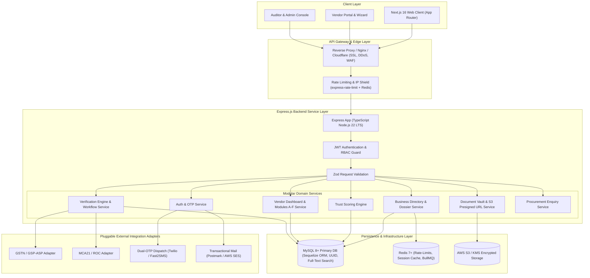
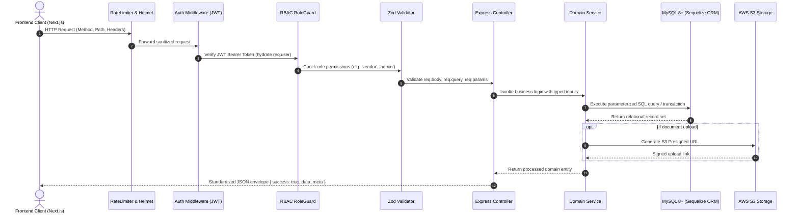

# BITAINTEL System Architecture & Express Backend Specification

## 1. Executive Architecture Summary

BITAINTEL is an enterprise-grade B2B business verification and trust intelligence platform designed around the foundational thesis: **"Verify Before You Trust"**. 

Unlike standard business directories or lead aggregators, BITAINTEL serves as an objective statutory validation and trust evaluation layer for enterprise supply chains. It features:
- Automated statutory cross-checks (GSTN, MCA, PAN, MSME/Udyam, EPFO).
- Multi-module business data capture (Modules A through F per SRS Phase 1).
- Tamper-evident encrypted document vault with audit trails.
- Transparent 0–100 weighted mathematical scoring engine.
- Granular confidentiality and consent controls for financial and customer/supply chain data.
- High-performance faceted Directory Explorer with trigram search and side-by-side comparative analytics.

---

## 2. High-Level System Architecture Diagram



---

## 3. Technology Stack Rationale

| Layer | Technology | Version | Architectural Justification |
|---|---|---|---|
| **Runtime** | Node.js | v22 LTS | High I/O throughput, non-blocking asynchronous event loop, native fetch, ESM support. |
| **Language** | TypeScript | v5.5+ | End-to-end type safety, compile-time schema verification, unified types with Next.js client. |
| **Framework** | Express.js | v4.21+ / v5.x | Mature, minimal, unopinionated, high performance, robust middleware ecosystem. |
| **Database** | MySQL | 8.0+ | ACID compliance, JSON columns, Full-Text Search, UUID, strong relational integrity. |
| **ORM** | Sequelize | 6.x+ | Full-featured ORM with TypeScript support, migrations, model associations, and connection pooling. |
| **Validation** | Zod | 3.23+ | Strict runtime request parsing, automatic TypeScript type inference, zero external dependencies. |
| **Authentication** | JSON Web Tokens | `jsonwebtoken` 9.x | Stateless authentication with short-lived access tokens (15m) and sliding refresh tokens (7d). |
| **Password Hashing** | Bcrypt | `bcrypt` 5.1+ | Cryptographically secure adaptive hashing (12 work factor rounds). |
| **Document Storage** | AWS S3 SDK | `@aws-sdk/client-s3` | Tamper-evident direct browser uploads via presigned signed PUT URLs with SHA-256 checksums. |
| **Security Headers** | Helmet + CORS | latest | Enforces CSP, HSTS, X-Frame-Options, secure origins. |

---

## 4. Layered Modular Monolith Architecture

The backend adopts the **Clean Architecture / Controller-Service-Repository pattern**, structured cleanly by business domain:

```
src/
├── server.ts              # Entry point: HTTP listener, clustering, graceful shutdown (SIGINT/SIGTERM)
├── app.ts                 # Express application initialization, middleware pipeline, global routing
├── config/                # Environment variables, database connection pool, logger
├── middlewares/           # Auth, RBAC, Zod validation, Rate limiter, Error handler
├── utils/                 # Standardized API response formatters, custom error classes, crypto helpers
└── modules/               # Domain modules
    ├── auth/              # Registration (Stage 1 & 2), Dual OTP verification, Login, Password Reset
    ├── businesses/        # Public directory search, Faceted filters, Dossier, Comparison
    ├── vendor/            # Vendor dashboard, Modules A through F
    ├── documents/         # Document vault, Presigned URLs, Tamper-evidence
    ├── verification/      # 11-step verification engine, Auditor queues, Approval/Rejection
    ├── scoring/           # 7-dimension scoring engine, Badge calculator
    ├── enquiries/         # Direct procurement leads & contact submissions
    ├── complaints/        # Dispute management & investigation workflow
    └── integrations/      # Pluggable adapters for GSTN, MCA, SMS, Email, S3
```

---

## 5. Request Lifecycle & Execution Pipeline

Each inbound HTTP request travels through a predictable, hardened pipeline:



---

## 6. Error Handling & Resiliency Strategy

1. **Operational vs Programmer Errors**:
   - `ApiError`: Extends native `Error` with HTTP status code, operational flag, and machine-readable error codes (e.g. `ERR_INVALID_CREDENTIALS`, `ERR_GSTIN_NOT_FOUND`).
   - Unhandled rejections and programmer exceptions trigger structured error logging and return an obfuscated `500 Internal Server Error` to the client.
2. **Standardized API Envelope**:
   - Every response adheres to a strict contract:
   ```json
   {
     "success": true,
     "data": { ... },
     "meta": {
       "page": 1,
       "limit": 12,
       "total": 120,
       "timestamp": "2026-11-03T17:45:00.000Z"
     }
   }
   ```
3. **Database Connection Resilience**:
   - MySQL connection pool via Sequelize ORM with automated reconnection, query timeout limits, and isolated transactions for multi-entity mutations.


