# BITAINTEL Database Schema & Data Dictionary Specification

This document details the relational data model for **BITAINTEL**, built on MySQL 8.0+. It defines all entities, relationships, field constraints, indexing strategies, and confidentiality visibility tiers per SRS Section 5 & 6.

---

## 1. Entity-Relationship Diagram (ERD)

```mermaid
erDiagram
    ENTERPRISE_ACCOUNTS ||--o{ USERS : "employs"
    ENTERPRISE_ACCOUNTS ||--o| BUSINESS_ENTITIES : "manages"
    USERS ||--o| BUSINESS_ENTITIES : "owns/represents"
    USERS ||--o{ USER_OTPS : "authenticates_with"
    USERS ||--o{ ENQUIRIES : "submits/receives"
    USERS ||--o{ NOTIFICATIONS : "receives"
    USERS ||--o{ AUDIT_LOGS : "performs"

    BUSINESS_ENTITIES ||--o| STATUTORY_IDENTIFIERS : "identifies_via"
    BUSINESS_ENTITIES ||--o| MODULE_A_COMPANY_INFO : "profile_details"
    BUSINESS_ENTITIES ||--o{ MODULE_B_MANAGEMENT : "governed_by"
    BUSINESS_ENTITIES ||--o| MODULE_C_OPERATIONS : "operates_with"
    BUSINESS_ENTITIES ||--o{ BUSINESS_PRODUCTS : "manufactures_or_trades"
    BUSINESS_ENTITIES ||--o| MODULE_D_CUSTOMER_SUPPLY : "distributes_via"
    BUSINESS_ENTITIES ||--o| MODULE_E_FINANCIAL : "finances"
    BUSINESS_ENTITIES ||--o| MODULE_F_COMPLIANCE : "complies_with"
    BUSINESS_ENTITIES ||--o{ CERTIFICATIONS : "holds"
    BUSINESS_ENTITIES ||--o{ VERIFICATION_CHECKPOINTS : "evaluated_against"
    BUSINESS_ENTITIES ||--o{ DOCUMENT_VAULT : "deposits_evidence_in"
    BUSINESS_ENTITIES ||--o{ TRUST_SCORE_SNAPSHOTS : "history_of_scores"
    BUSINESS_ENTITIES ||--o{ ENQUIRIES : "receives_leads"
    BUSINESS_ENTITIES ||--o{ COMPLAINTS : "audited_for"

    USERS ||--o{ COMPARISON_LISTS : "creates"
    COMPARISON_LISTS ||--o{ COMPARISON_ITEMS : "contains"
    BUSINESS_ENTITIES ||--o{ COMPARISON_ITEMS : "compared_in"
```



---

## 2. Table-by-Table Data Dictionary

### 2.1 Table: `users`
Stores all platform users across roles (Super Admin, Verifier, Vendor, Buyer).
| Column Name | Data Type | Constraints | Description |
|---|---|---|---|
| `id` | UUID | PK, DEFAULT `UUID()` | Immutable unique identifier. |
| `account_id` | UUID | FK -> `enterprise_accounts.id` | Associated enterprise organization. |
| `email` | VARCHAR(255) | UNIQUE, NOT NULL | Primary email (case-insensitive). |
| `mobile` | VARCHAR(25) | NOT NULL | International E.164 mobile phone. |
| `full_name` | VARCHAR(200) | NOT NULL | User's legal representative name. |
| `password_hash` | VARCHAR(255) | NOT NULL | Bcrypt salted password hash (12 work factor). |
| `role` | `user_role_enum` | DEFAULT `'vendor'` | RBAC role (`super_admin`, `admin`, `verification_officer`, `quality_auditor`, `vendor`, `buyer`). |
| `user_type` | VARCHAR(100) | DEFAULT `'Vendor / Direct Manufacturer'` | UI category selection from registration wizard. |
| `designation` | VARCHAR(150) | DEFAULT `'Director / Authorized Signatory'` | Executive title. |
| `is_email_verified`| BOOLEAN | DEFAULT `FALSE` | Email OTP verification status. |
| `is_mobile_verified`| BOOLEAN | DEFAULT `FALSE` | Mobile SMS OTP verification status. |
| `mfa_enabled` | BOOLEAN | DEFAULT `FALSE` | Multi-factor TOTP flag. |
| `mfa_secret` | VARCHAR(100) | NULLABLE | Encrypted TOTP authenticator secret. |
| `avatar_initials`| VARCHAR(6) | DEFAULT `'VU'` | Two-letter initials rendered on badges. |
| `status` | VARCHAR(30) | DEFAULT `'ACTIVE'` | Account state (`ACTIVE`, `SUSPENDED`, etc.). |
| `created_at` | DATETIME | DEFAULT `NOW()` | Timestamp created. |
| `updated_at` | DATETIME | DEFAULT `NOW()` | Timestamp updated. |

---

### 2.2 Table: `user_otps`
Handles one-time verification tokens for Stage 1 registration, password reset, and sensitive actions.
| Column Name | Data Type | Constraints | Description |
|---|---|---|---|
| `id` | UUID | PK, DEFAULT `UUID()` | Primary Key. |
| `user_id` | UUID | FK -> `users.id` (CASCADE) | Linked user account (if authenticated). |
| `target_type` | VARCHAR(20) | CHECK (`'email'`, `'mobile'`) | Destination channel. |
| `target_value` | VARCHAR(255) | NOT NULL | Sanitized email or E.164 phone number. |
| `otp_code` | VARCHAR(10) | NOT NULL | 4 or 6 digit verification code. |
| `purpose` | VARCHAR(50) | CHECK (`'registration'`, `'login'`, `'password_reset'`) | Intent for dispatch. |
| `attempts` | INT | DEFAULT `0` | Failed attempts counter (brute-force defense). |
| `max_attempts` | INT | DEFAULT `5` | Maximum allowable attempts before lock. |
| `is_consumed` | BOOLEAN | DEFAULT `FALSE` | Flag set to `TRUE` upon successful verification. |
| `expires_at` | DATETIME | NOT NULL | Expiry timestamp (typically 10 minutes TTL). |

---

### 2.3 Table: `business_entities`
The central corporate registry powering the public Directory Explorer and trust dossiers.
| Column Name | Data Type | Constraints | Description |
|---|---|---|---|
| `id` | UUID | PK, DEFAULT `UUID()` | Entity primary key. |
| `owner_user_id` | UUID | FK -> `users.id` (SET NULL) | Registered owner or representative. |
| `slug` | VARCHAR(150) | UNIQUE, NOT NULL | URL slug (e.g. `meridian-steel-works`). |
| `name` | VARCHAR(255) | NOT NULL | Primary brand / commercial display name. |
| `legal_name` | VARCHAR(255) | NOT NULL | Full statutory corporate legal name. |
| `trade_name` | VARCHAR(255) | NULLABLE | Registered trade name from GSTN/MCA. |
| `company_type` | VARCHAR(100) | NOT NULL | Constitution (Pvt Ltd, Public Ltd, LLP, Partnership). |
| `registration_no`| VARCHAR(100) | NULLABLE | State or Registrar registration number. |
| `initials` | VARCHAR(6) | NOT NULL | 2-letter avatar initials (e.g. `MS`, `NC`). |
| `industry` | VARCHAR(100) | NOT NULL | High-level industry sector. |
| `category` | VARCHAR(150) | NULLABLE | Granular sub-category or niche specialization. |
| `location` | VARCHAR(200) | NOT NULL | Combined display location (e.g. `Pune, Maharashtra`). |
| `city` | VARCHAR(100) | NOT NULL | City name. |
| `state` | VARCHAR(100) | NOT NULL | State name. |
| `registered_address`| TEXT | NOT NULL | Full physical registered office address. |
| `postal_code` | VARCHAR(20) | NULLABLE | PIN code. |
| `website` | VARCHAR(255) | NULLABLE | Corporate URL. |
| `year_established`| INT | NOT NULL DEFAULT `2012` | Year of establishment / incorporation. |
| `age` | INT | NOT NULL DEFAULT `0` | Operational tenure in years. |
| `level` | SMALLINT | CHECK (1 TO 4) | Audited verification tier level (1 to 4). |
| `score` | DECIMAL(5,2)| CHECK (0.00 TO 100.00) | Current computed BITAINTEL composite trust score. |
| `badge` | `tier_badge_enum`| DEFAULT `'Under Review'` | `Platinum`, `Gold`, `Silver`, `Verified`, `Under Review`. |
| `summary` | TEXT | NOT NULL | Executive corporate summary. |
| `turnover` | VARCHAR(100) | NOT NULL | Annual turnover bracket (e.g. `₹50–100 crore`). |
| `employees` | VARCHAR(50) | NOT NULL | Headcount band (e.g. `250–500`). |
| `verified` | BOOLEAN | DEFAULT `FALSE` | Boolean flag indicating audited verification status. |
| `verification_status`| `verification_status_enum`| DEFAULT `'registered'` | 10-state lifecycle status per SRS 5.6. |
| `is_publicly_visible`| BOOLEAN | DEFAULT `TRUE` | Directory search index visibility toggle. |
| `last_audited` | DATETIME | DEFAULT `NOW()` | Timestamp of most recent verification review. |

---

### 2.4 Table: `statutory_identifiers`
Stores official government identification records and real-time registry synchronization status.
| Column Name | Data Type | Constraints | Description |
|---|---|---|---|
| `id` | UUID | PK | Unique identifier. |
| `business_id` | UUID | FK -> `business_entities.id` (UNIQUE, CASCADE) | 1-to-1 link to business entity. |
| `cin` | VARCHAR(30) | UNIQUE, NULLABLE | Corporate Identification Number (21 characters) or LLPIN. |
| `gstin` | VARCHAR(15) | UNIQUE, NULLABLE | 15-character Goods and Services Tax Identification Number. |
| `pan` | VARCHAR(10) | NULLABLE | 10-character Permanent Account Number. |
| `udyam_msme` | VARCHAR(40) | NULLABLE | Udyam Registration Certificate number. |
| `iec_code` | VARCHAR(30) | NULLABLE | DGFT Import Export Code. |
| `mca_status` | VARCHAR(50) | DEFAULT `'ACTIVE'` | Status directly from MCA21 portal (`ACTIVE`, `STRUCK_OFF`). |
| `gstn_status` | VARCHAR(50) | DEFAULT `'ACTIVE'` | Status from GSTN API (`ACTIVE`, `SUSPENDED`, `CANCELLED`). |
| `filing_frequency`| VARCHAR(50) | DEFAULT `'Monthly (GSTR-3B)'` | GST filing continuity. |
| `director_dins` | JSON | DEFAULT `'[]'::JSON` | Array of verified Director Identification Numbers & Names. |
| `statutory_payload`| JSON | DEFAULT `'{}'::JSON` | Raw signed response payload from government GSP/ASP API. |
| `last_synced_at` | DATETIME | DEFAULT `NOW()` | Timestamp of last API reconciliation call. |

---

### 2.5 Tables: Business Modules A through F (SRS Section 5.3)

| Table | SRS Module | Purpose | Public vs Confidential |
|---|---|---|---|
| `module_a_company_info` | Module A | Date of incorporation, ROC jurisdiction, authorized & paid-up capital. | **Public** |
| `module_b_management` | Module B | Directors, promoters, KMP with DINs and consent flags. | **Public (Sensitive KYC Redacted)** |
| `module_c_operations` | Module C | Manufacturing/trading footprint, plant area, capacity, EPFO headcount. | **Public Summary / Audited Detail** |
| `business_products` | Module C | Products manufactured or supplied, HSN codes, specifications. | **Public** |
| `module_d_customer_supply` | Module D | Client categories, export %, regional distribution network. | **Confidential (Requires Consent / NDA)** |
| `module_e_financial` | Module E | Turnover bands, bank solvency, CA UDIN, audited statements. | **Confidential (Requires Consent / NDA)** |
| `module_f_compliance` | Module F | 24-month GSTR-3B filing regularity, pollution CTO, non-debarment. | **Public Score Signals / Private Evidence** |

---

### 2.6 Table: `document_vault`
Centralized repository for all statutory proof documents with cryptographic integrity.
| Column Name | Data Type | Constraints | Description |
|---|---|---|---|
| `id` | UUID | PK | Vault Document ID. |
| `business_id` | UUID | FK -> `business_entities.id` (CASCADE) | Linked business entity. |
| `category_id` | VARCHAR(50) | NOT NULL | Category identifier (e.g. `cat_inc`, `cat_gst`, `cat_addr`, `cat_bank`). |
| `category_name` | VARCHAR(200) | NOT NULL | Human-readable category label. |
| `module_code` | VARCHAR(20) | NOT NULL | Module A through F. |
| `file_name` | VARCHAR(255) | NOT NULL | Original sanitized file name. |
| `s3_key` | VARCHAR(500) | NOT NULL | Private AWS S3 object path. |
| `file_size_bytes`| BIGINT | NOT NULL | File size in bytes (max 15MB). |
| `mime_type` | VARCHAR(100) | NOT NULL | Validated MIME type (`application/pdf`, etc.). |
| `sha256_checksum`| CHAR(64) | NOT NULL | SHA-256 hash for tamper evidence. |
| `version` | VARCHAR(20) | DEFAULT `'v1.0'` | Document revision version. |
| `status` | `doc_status_enum`| DEFAULT `'PENDING'` | `PENDING`, `VERIFIED`, `REJECTED`, `EXPIRED`, `ACTION_REQUIRED`. |
| `expiry_date` | DATE | NULLABLE | Document validity expiration date. |
| `rejection_reason`| TEXT | NULLABLE | Reason provided by verification team if rejected. |
| `verifier_name` | VARCHAR(150) | NULLABLE | Full name and title of verifying auditor. |
| `verified_by` | UUID | FK -> `users.id` (SET NULL) | User ID of verifier. |
| `verified_at` | DATETIME | NULLABLE | Timestamp when verified. |

---

### 2.7 Table: `verification_checkpoints`
Stores the detailed score breakdown per category shown on the public profile and audit report.
| Column Name | Data Type | Constraints | Description |
|---|---|---|---|
| `id` | UUID | PK | Checkpoint ID. |
| `business_id` | UUID | FK -> `business_entities.id` (CASCADE) | Linked business entity. |
| `checkpoint_type`| VARCHAR(100) | NOT NULL | `'identity'`, `'documents'`, `'contact'`, `'address'`, `'profile'`, etc. |
| `title` | VARCHAR(150) | NOT NULL | Display label (e.g. `'Corporate Legal Identity'`). |
| `achieved_score` | DECIMAL(5,2)| NOT NULL | Points awarded (e.g. `10.00`). |
| `max_score` | DECIMAL(5,2)| NOT NULL | Maximum available points (e.g. `10.00`). |
| `percentage` | DECIMAL(5,2)| NOT NULL | Percentage achieved (e.g. `100.00`). |
| `status` | VARCHAR(50) | DEFAULT `'VERIFIED'` | Checkpoint audit status. |
| `notes` | TEXT | NULLABLE | Auditor remarks and evidence citations. |

---

### 2.8 Table: `enquiries`
Captures direct B2B buyer leads submitted via the verified enquiry modal.
| Column Name | Data Type | Constraints | Description |
|---|---|---|---|
| `id` | UUID | PK | Enquiry ID. |
| `business_id` | UUID | FK -> `business_entities.id` (CASCADE) | Target vendor entity. |
| `buyer_user_id` | UUID | FK -> `users.id` (SET NULL) | Authenticated buyer ID (if logged in). |
| `sender_name` | VARCHAR(200) | NOT NULL | Full name of enquirer. |
| `sender_email` | VARCHAR(255) | NOT NULL | Corporate email address. |
| `sender_phone` | VARCHAR(30) | NULLABLE | Contact telephone number. |
| `sender_company`| VARCHAR(255) | NULLABLE | Sourcing organization name. |
| `message` | TEXT | NOT NULL | Procurement intent / specifications. |
| `status` | `enquiry_status_enum`| DEFAULT `'NEW'` | `NEW`, `VIEWED`, `RESPONDED`, `IN_DISCUSSION`, `CLOSED`, `REJECTED`. |
| `vendor_notes` | TEXT | NULLABLE | Internal notes by vendor team. |

---

## 3. Privacy & Confidentiality Data Governance Matrix

The platform enforces data access rules at both the SQL view layer and the Express controller policy layer:

```
+------------------------------------+---------------+-----------------+--------------------+
| Data Attribute                     | Public Viewer | Verified Buyer  | Vendor / Owner     |
+------------------------------------+---------------+-----------------+--------------------+
| Legal Name, CIN, GSTIN, Location   | VISIBLE       | VISIBLE         | VISIBLE            |
| Composite Trust Score & Badge      | VISIBLE       | VISIBLE         | VISIBLE            |
| Public Products & Certifications   | VISIBLE       | VISIBLE         | VISIBLE            |
| Verification Checkpoint Scores     | VISIBLE       | VISIBLE         | VISIBLE            |
| Director Names & Active DINs       | VISIBLE       | VISIBLE         | VISIBLE            |
| Director KYC / Personal PAN / Phone| HIDDEN        | HIDDEN          | VISIBLE            |
| Customer Categories & Export %     | HIDDEN        | CONSENT REQUIRED| VISIBLE            |
| Bank Solvency & CA Balance Sheets  | HIDDEN        | CONSENT REQUIRED| VISIBLE            |
| Raw S3 Document Download Links     | HIDDEN        | CONSENT REQUIRED| VISIBLE            |
| Internal Audit Remarks & Logs      | HIDDEN        | HIDDEN          | ADMIN/AUDITOR ONLY |
+------------------------------------+---------------+-----------------+--------------------+
```


