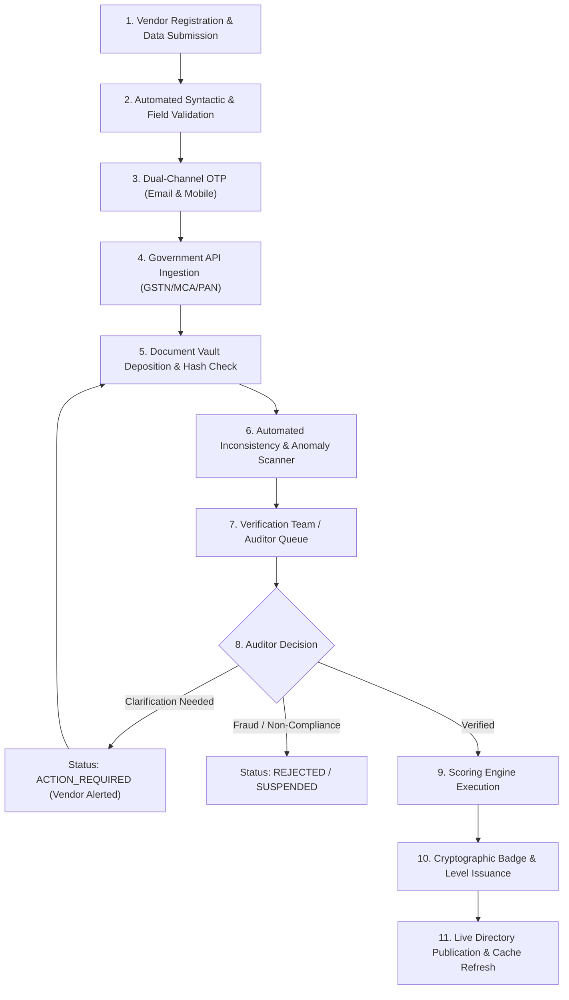
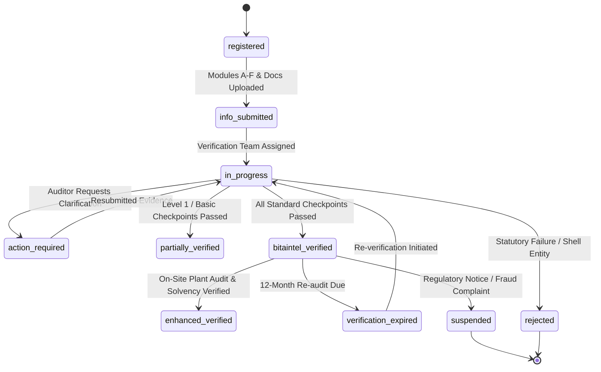

# BITAINTEL Scoring Algorithm & Verification Workflow Engine

This specification details the mathematical scoring logic, tiering rules, and the 11-step verification state machine powering **BITAINTEL**.

---

## 1. Weighted Composite Trust Score Formula

The BITAINTEL composite score ($S$) is calculated on a 0–100 scale using 7 weighted statutory dimensions per SRS Section 5.7:

$$S = \sum_{i=1}^{7} (W_i \times D_i)$$

Where:
- $W_i$ is the fixed dimension weight ($\sum W_i = 1.00$).
- $D_i$ is the normalized dimension score ($0.00 \le D_i \le 100.00$).

### 1.1 Dimension Breakdown & Weight Distribution

| Index ($i$) | Dimension Name | Weight ($W_i$) | Max Pts | Core Statutory Criteria & Automated Inputs |
|---|---|---|---|---|
| **$D_1$** | **Corporate Legal Identity** | **20%** | 20.0 | MCA active status, valid CIN/LLPIN, Director DIN verification, PAN entity matching, registered office match. |
| **$D_2$** | **Government Tax Registry** | **20%** | 20.0 | Active GSTIN status, 24-month continuous GSTR-3B filing, GSTR-1 turnover continuity, MSME/Udyam validity. |
| **$D_3$** | **Operations & Physical Tenure** | **15%** | 15.0 | Operational age ($age \ge 10 \text{ yrs} \to 100\%$, $age \ge 5 \to 80\%$), physical premise deed/utility bill, EPFO headcount. |
| **$D_4$** | **Documents & Certifications** | **15%** | 15.0 | Valid ISO 9001/27001/14001, IATF 16949, WHO-GMP, CE, NPOP accreditation with unexpired valid dates. |
| **$D_5$** | **Financial & Solvency Signals** | **15%** | 15.0 | Audited balance sheets with CA UDIN, bank solvency confirmation, verified turnover consistency band. |
| **$D_6$** | **Compliance & Risk Safeguards** | **10%** | 10.0 | State Pollution Control Board Consent (CTO), clean court litigation record, non-debarment declaration. |
| **$D_7$** | **Profile Completeness** | **5%** | 5.0 | Complete product catalog, executive bios, capabilities taxonomy, and contact authorizations. |

$$\text{Total Available Points} = 100.00$$

---

## 2. Tier Classification & Badge Award Matrix

Scores map directly to verification tiers and letter grades. 

> [!IMPORTANT]
> A BITAINTEL Trust Score represents documented statutory legitimacy and compliance continuity. It is not an equity credit rating or financial guarantee.

| Score Range | Verification Tier | Grade | Cryptographic Badge | Public Verification Level |
|---|---|---|---|---|
| **95.00 – 100.00** | **Platinum Tier** | **Grade A+** | Platinum Shield | Level 4 (Highest Audited) |
| **90.00 – 94.99** | **Platinum Tier** | **Grade A** | Platinum Shield | Level 4 |
| **85.00 – 89.99** | **Gold Tier** | **Grade B+** | Gold Shield | Level 3 or 4 |
| **75.00 – 84.99** | **Gold Tier** | **Grade B** | Gold Shield | Level 3 |
| **70.00 – 74.99** | **Silver Tier** | **Grade C+** | Silver Shield | Level 2 or 3 |
| **60.00 – 69.99** | **Silver Tier** | **Grade C** | Silver Shield | Level 2 |
| **40.00 – 59.99** | **Audited / Verified** | **Grade D** | Verified Check | Level 1 |
| **0.00 – 39.99** | **Under Review** | **Grade F** | Under Review | Not Indexed (Unverified) |

---

## 3. The 11-Step Verification Workflow Engine

### Detailed Execution of the 11 Steps:
1. **Vendor Registration & Data Submission**: Account creation with legal business credentials (CIN, GSTIN, PAN).
2. **Automated Syntactic & Field Validation**: Zod schema validation checks format of PAN (10 chars), GSTIN (15 chars), and CIN (21 chars).
3. **Dual-Channel OTP Verification**: Dispatches simultaneous numeric codes to corporate email and authorized representative's mobile.
4. **Government API Ingestion**: Pluggable GSP/ASP adapter fetches official GST status, registration date, legal name, and tax filing continuity.
5. **Document Vault Deposition**: Uploaded documents are verified against SHA-256 hashes for tamper evidence.
6. **Automated Inconsistency Scanner**: Flags discrepancies between submitted company name and government GSTN/MCA records.
7. **Verification Team Queue**: Human auditor inspects physical premises proof, factory licenses, and ISO accreditation bodies.
8. **Auditor Decision**: Auditor approves, requests clarification, or rejects the submission with documented reasons.
9. **Scoring Engine Execution**: The 7-dimension mathematical formula calculates the composite index.
10. **Badge Issuance**: Tier badge (Platinum, Gold, Silver, Verified) is stamped with the audit date (e.g. `BITAINTEL Verified — October 2026`).
11. **Live Publication**: Record is updated in MySQL, public directory cache in Redis is invalidated, and notifications are sent.

---

## 4. Lifecycle State Machine (10 States)

| State | Description | Public Directory Visibility |
|---|---|---|
| `registered` | Account and preliminary basic details created. | Hidden |
| `info_submitted` | Modules A–F and required documents submitted into vault. | Hidden |
| `in_progress` | Under active review by verification team. | Hidden |
| `action_required` | Document rejected or clarification requested from vendor. | Hidden |
| `partially_verified` | Identity and basic tax confirmed, pending operational audit. | Visible (Level 1) |
| `bitaintel_verified` | Complete statutory and document audit passed. | Visible (Level 2/3) |
| `enhanced_verified` | Comprehensive audit with ISO and plant verification passed. | Visible (Level 4 - Platinum) |
| `verification_expired` | 12-month re-audit deadline passed without renewal. | Flagged Badge |
| `suspended` | Temporarily withheld due to dispute or regulatory revocation. | Suspended Notice |
| `rejected` | Failed statutory checks or proven shell company. | Blacklisted |

