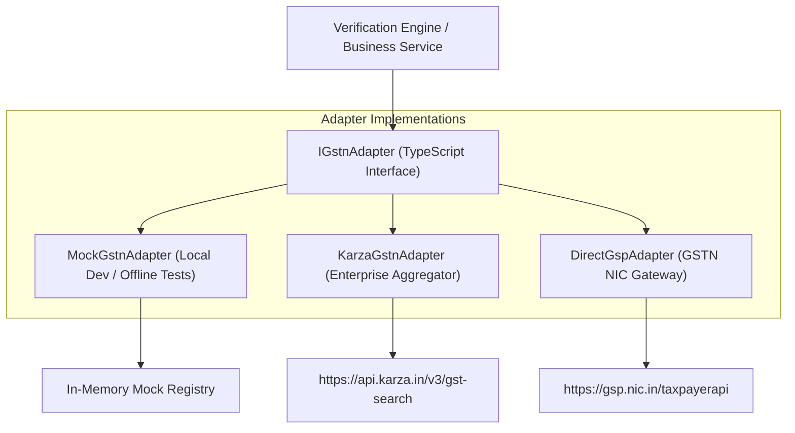
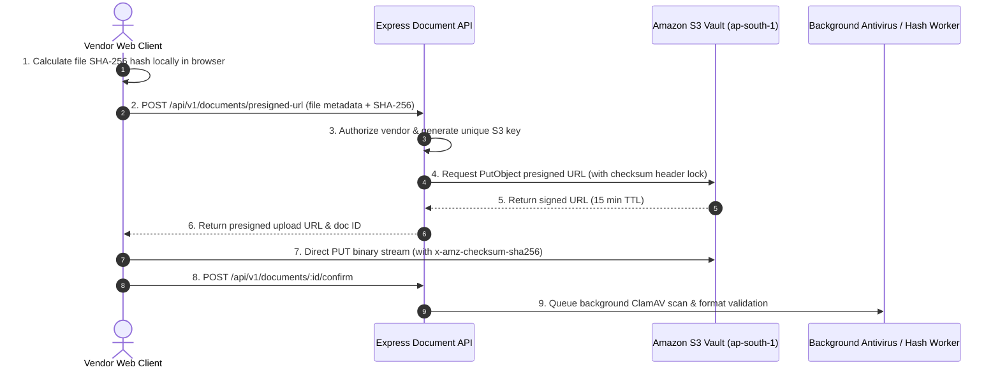

# BITAINTEL External Integrations & Security Architecture Guide

## 1. Pluggable Government & Registry Integration Layer

Per SRS Section 3.1 & 5.5, all external government registries (GSTN, MCA, PAN, MSME, EPFO) are isolated behind a **pluggable Adapter Interface**. 

This decouples the BITAINTEL core platform from specific commercial API aggregators (e.g., Karza, Signzy, Perfios, ClearTax, or direct NIC/GSTN GSP gateways), enabling seamless provider migration without modifying business services.



### 1.1 The Common Interface Contract (`IGstnAdapter`)
```typescript
export interface GstnVerificationResult {
  gstin: string;
  legalName: string;
  tradeName: string;
  status: 'ACTIVE' | 'CANCELLED' | 'SUSPENDED';
  taxpayerType: 'Regular' | 'Composition';
  registrationDate: string;
  principalAddress: {
    building: string;
    street: string;
    city: string;
    state: string;
    pincode: string;
  };
  filingContinuity24Months: boolean;
  rawPayload: Record<string, unknown>;
}

export interface IGstnAdapter {
  verifyGstin(gstin: string): Promise<GstnVerificationResult>;
}
```

---

## 2. Document Vault Cryptography & S3 Architecture

### 2.1 Direct-to-S3 Tamper-Evident Deposition

To prevent multi-megabyte file uploads from overwhelming Node.js application servers, uploads occur **directly from the client browser to AWS S3** via presigned cryptographic URLs.



### 2.2 Security Controls on S3 Vault:
1. **Server-Side Encryption**: `aws:kms` encryption enforced using dedicated customer-managed keys (CMK).
2. **Checksum Enforcement**: The presigned URL requires the client to supply `x-amz-checksum-sha256`. S3 rejects the upload if even a single byte differs.
3. **Public Access Block**: 100% of public bucket access is blocked at the AWS Account level.
4. **Time-Limited Signed Retrieval**: Files are only viewable by authorized verifiers or consented buyers via temporary presigned GET URLs (5-minute TTL).

---

## 3. Authentication & RBAC Security Model

### 3.1 Token Lifecycle
- **Access Token**: JSON Web Token (JWT) signed with HMAC-SHA256 or RS256. 
  - Validity: **15 minutes**.
  - Payload: `{ sub: userId, role: userRole, businessId: businessId }`.
- **Refresh Token**: Opaque cryptographically random 256-bit string stored in `refresh_tokens` database table with device footprint.
  - Validity: **7 days** with sliding renewal.

### 3.2 Role-Based Access Control (RBAC) Matrix

| Endpoint Group | `public` | `buyer` | `vendor` | `verification_officer` | `admin` | `super_admin` |
|---|:---:|:---:|:---:|:---:|:---:|:---:|
| `GET /api/v1/businesses` | ✅ | ✅ | ✅ | ✅ | ✅ | ✅ |
| `GET /api/v1/businesses/:id` | ✅ | ✅ | ✅ | ✅ | ✅ | ✅ |
| `POST /api/v1/enquiries` | ✅ | ✅ | ✅ | ✅ | ✅ | ✅ |
| `GET /api/v1/vendor/dashboard` | ❌ | ❌ | ✅ (Own) | ❌ | ✅ | ✅ |
| `POST /api/v1/documents/presigned-url` | ❌ | ❌ | ✅ (Own) | ❌ | ✅ | ✅ |
| `GET /api/v1/verification/queue` | ❌ | ❌ | ❌ | ✅ | ✅ | ✅ |
| `POST /api/v1/verification/decision` | ❌ | ❌ | ❌ | ✅ | ✅ | ✅ |
| `GET /api/v1/admin/kpis` | ❌ | ❌ | ❌ | ❌ | ✅ | ✅ |

---

## 4. Production Hardening & Anti-Scraping Defenses

1. **Anti-Scraping Rate Limiting**:
   - Public Directory Explorer: Maximum **60 requests/minute per IP** using Redis token bucket.
   - Search queries returning excessive pages trigger automated CAPTCHA challenges.
2. **SQL Injection Immunity**:
   - Zero raw string concatenation in SQL execution. Every single database parameter uses parameterized place-markers (`?, ?, ...`).
3. **HTTP Header Hardening**:
   - **Helmet.js** enforces strict HTTP Strict Transport Security (`HSTS`), `X-Frame-Options: DENY`, `X-Content-Type-Options: nosniff`, and Content Security Policy (`CSP`).
4. **CORS Policies**:
   - Whitelist restricted to authorized domain origins (e.g. `https://bitaintel.com` and `http://localhost:3000`).
5. **Audit Trail Immutability**:
   - All score alterations, document status shifts, and role elevations write to the `audit_logs` table with client IP, user agent, and before/after JSON diffs.


