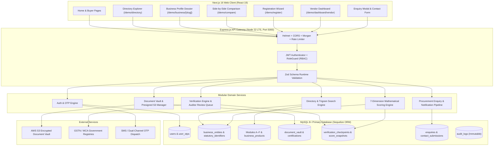
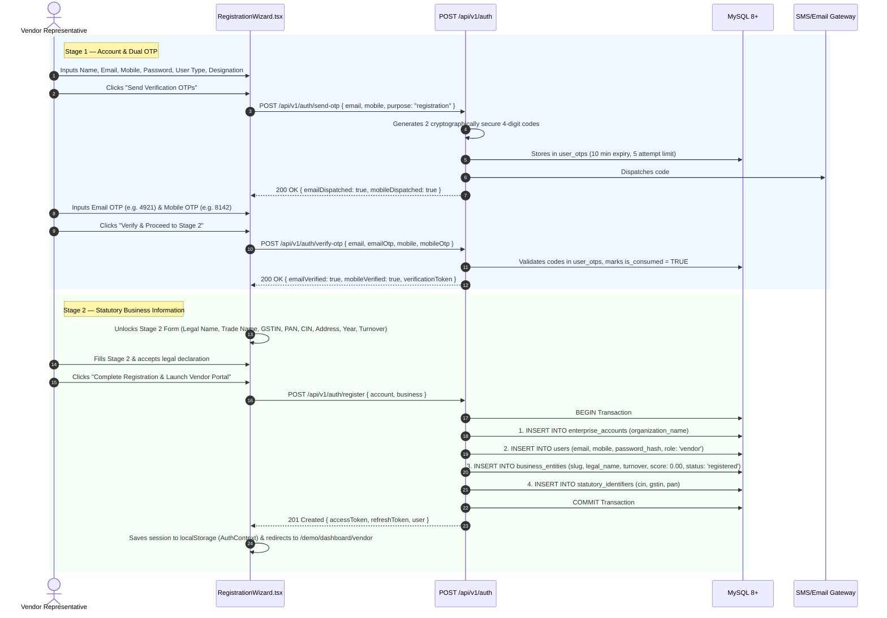
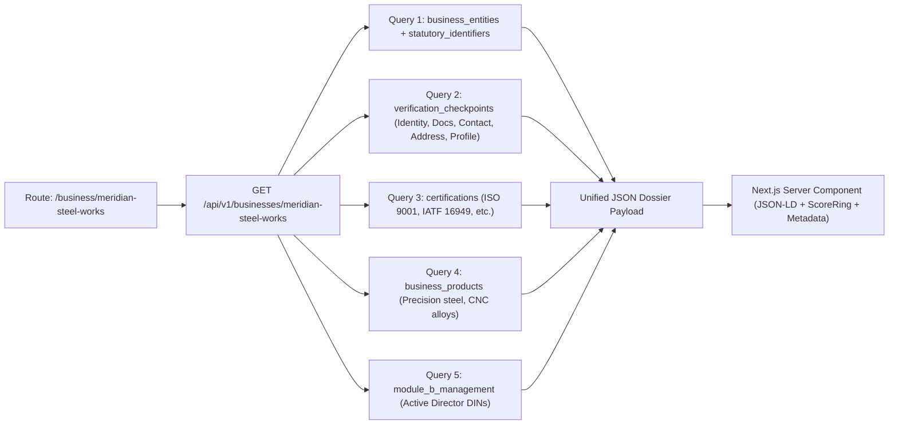
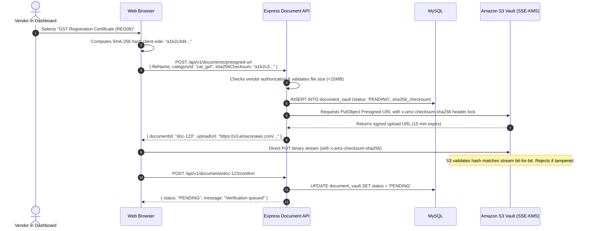

# BITAINTEL Full-Stack System Guide: How Frontend & Backend Work Together

This master guide explains **end-to-end how every component, database table, API route, and user interaction in BITAINTEL functions** in production.

---

## 1. High-Level Architecture & Lifecycle



---

## 2. Deep Dive: How Each Feature Works End-to-End

---

### Feature 1: The 2-Stage Vendor Registration Wizard (`/demo/register`)

The registration wizard turns unverified companies into registered vendor entities through dual cryptographic identity verification followed by statutory intake.



---

### Feature 2: High-Performance Directory Search & Filtering (`/demo/directory`)

The Directory Explorer handles search, multi-faceted filtering, sorting, and pagination across thousands of enterprises.

#### How It Works:
1. **Typing in Search Box (`q`)**:
   - The frontend uses React `useDeferredValue(query)` to debounce keystrokes.
   - The query matches against **5 different columns**: Company Display Name, Statutory Legal Name, Trade Name, Location, and Registered Products via MySQL `Full-Text Search (FULLTEXT INDEX)` FULLTEXT indexes.
   - Example SQL executed under the hood:
     ```sql
     SELECT be.*, si.gstin, si.cin,
            (SELECT JSON_ARRAYAGG(bp.product_name) FROM business_products bp WHERE bp.business_id = be.id) AS products
     FROM business_entities be
     LEFT JOIN statutory_identifiers si ON si.business_id = be.id
     WHERE be.is_publicly_visible = TRUE
       AND (be.name LIKE ? (case-insensitive via COLLATE) OR be.legal_name LIKE ? (case-insensitive via COLLATE) OR si.gstin LIKE ? (case-insensitive via COLLATE) OR EXISTS (
             SELECT 1 FROM business_products bp WHERE bp.business_id = be.id AND bp.product_name LIKE ? (case-insensitive via COLLATE)
           ))
       AND be.industry = ?
       AND be.level >= ?
       AND be.score >= ?
       AND be.verified = TRUE
     ORDER BY be.score DESC
     LIMIT 12 OFFSET 0;
     ```
2. **Filter Combinations**:
   - Filter pills (`All industries`, `Manufacturing`, `IT Services`) filter by `industry`.
   - Tier Level dropdown filters by `level >= selectedLevel`.
   - Score Slider filters by `score >= minimumScore`.
   - Verified Checkbox toggles `verified = TRUE`.
3. **Sorting**:
   - `score`: Highest trust rating first (`ORDER BY be.score DESC`).
   - `tenure`: Most established companies first (`ORDER BY be.age DESC`).
   - `name`: Alphabetical order (`ORDER BY be.name ASC`).

---

### Feature 3: Business Profile & Audited Dossier (`/demo/business/[slug]`)

When a user visits a business page like `/demo/business/meridian-steel-works`, the backend constructs a dossier combining statutory registries, audit history, quality certifications, and products.

#### Data Fetching Lifecycle:


#### What Gets Rendered:
- **SEO & Structured Data**: Server automatically injects Google Schema.org `Corporation` and `BreadcrumbList` JSON-LD tags.
- **ScoreRing**: Shows composite score (e.g. `96/100`), Tier Badge (`Platinum`), and Level (`Level 4 Audited`).
- **5 Checkpoint Rings**:
  - Corporate Legal Identity: `10/10` (MCA active, valid CIN).
  - Statutory Document Dossier: `20/20` (Incorporation, 24-month GSTR-3B filed).
  - Representative Identity: `5/5` (Dual OTP verified signatory).
  - Physical Plant Geolocation: `5/5` (MIDC Bhosari industrial plot verified).
  - Profile Completeness: `15/15` (Complete products, capabilities & team).

---

### Feature 4: Side-by-Side Comparison (`/demo/compare`)

Users can compare 2 to 4 companies simultaneously (e.g., `/demo/compare?ids=meridian-steel-works,nexora-cloud-systems`).

1. **Frontend**: Sends comma-separated IDs via query string `?ids=id1,id2,id3,id4`.
2. **Backend Controller**:
   - Parses and validates that between 2 and 4 valid slugs/IDs are provided.
   - Executes parallel parameterized queries for all entities.
   - Excludes sensitive proprietary fields (financial statements, confidential customer lists).
3. **Response**: Delivers normalized matrices comparing score breakdowns, statutory statuses, active ISO certificates, operational ages, employee headcount brackets, and turnover bands.

---

### Feature 5: Vendor Dashboard & Modules A through F (`/demo/dashboard/vendor`)

The vendor dashboard is the authenticated operational portal where companies manage their trust profile per **SRS Phase 1 Section 5.3 & 5.4**.

#### Structure of the 6 SRS Modules:
```
┌────────────────────────────────────────────────────────────────────────┐
│ MODULE A: Company Information (Legal identity, addresses, contacts)    │
│ Table: module_a_company_info | Max Score: 20% | Status: Verified       │
├────────────────────────────────────────────────────────────────────────┤
│ MODULE B: Management & Key Personnel (Directors, promoters, KMP, DINs) │
│ Table: module_b_management   | Max Score: 20% | Status: Verified       │
├────────────────────────────────────────────────────────────────────────┤
│ MODULE C: Operations & Capabilities (Plant sqft, machinery, capacity)  │
│ Table: module_c_operations   | Max Score: 15% | Status: In Review      │
├────────────────────────────────────────────────────────────────────────┤
│ MODULE D: Customer & Supply (Sectors, export %, geographic coverage)   │
│ Table: module_d_customer_supply | Max Score: 15% | PRIVATE / NDA ONLY  │
├────────────────────────────────────────────────────────────────────────┤
│ MODULE E: Financial & Banking (Turnover bands, bank solvency, CA UDIN) │
│ Table: module_e_financial    | Max Score: 15% | PRIVATE / NDA ONLY     │
├────────────────────────────────────────────────────────────────────────┤
│ MODULE F: Statutory Compliance (GSTR-3B continuity, pollution CTO)     │
│ Table: module_f_compliance   | Max Score: 15% | Status: Verified       │
└────────────────────────────────────────────────────────────────────────┘
```

#### Privacy Enforcement:
- Modules A, B, C, and F produce public trust signals and badges.
- Modules D & E are **private by default**. Third parties can only view them by requesting explicit vendor consent under mutual NDA tokens via `document_access_consents`.

---

### Feature 6: Tamper-Evident Document Vault (`/api/v1/documents`)

To ensure document integrity without overburdening the Node.js API servers, BITAINTEL utilizes **direct-to-S3 browser uploads with cryptographic checksum locks**.



---

### Feature 7: Mathematical Scoring Engine & Badge Calculator

The composite score ($S$) is computed on a 0–100 scale using the 7 weighted statutory dimensions:

$$S = (0.20 \times D_1) + (0.20 \times D_2) + (0.15 \times D_3) + (0.15 \times D_4) + (0.15 \times D_5) + (0.10 \times D_6) + (0.05 \times D_7)$$

Where:
- $D_1$ (**Corporate Identity - 20%**): MCA active status, valid CIN, Director DIN checks.
- $D_2$ (**Government Tax Registry - 20%**): Active GSTIN, continuous 24-month GSTR-3B filings, PAN matching.
- $D_3$ (**Operational Tenure - 15%**): Operational age $\ge 10\text{ yrs} \to 100\%$, premise title/utility proof.
- $D_4$ (**Documents & Certifications - 15%**): Active ISO 9001/27001/14001, IATF 16949, WHO-GMP.
- $D_5$ (**Financial Solvency - 15%**): Audited statements with CA UDIN, bank solvency letter.
- $D_6$ (**Compliance & Risk - 10%**): Pollution NOC, clean court records, non-debarment affidavit.
- $D_7$ (**Profile Completeness - 5%**): Complete product catalog, executive team bios.

#### Tier & Badge Classification:
- **Score $\ge 90$**: **Platinum Tier** (`Grade A+` for $\ge 95$, `Grade A` for $\ge 90$) $\to$ **Level 4**
- **Score $75 - 89.99$**: **Gold Tier** (`Grade B+` for $\ge 85$, `Grade B` for $\ge 75$) $\to$ **Level 3**
- **Score $60 - 74.99$**: **Silver Tier** (`Grade C+` for $\ge 70$, `Grade C` for $\ge 60$) $\to$ **Level 2**
- **Score ?0 - 59.99$**: **Verified Tier** (`Grade D`) $\to$ **Level 1**
- **Score $< 40$**: **Under Review** (`Grade F`) $\to$ Not indexed in public directory

---

### Feature 8: Verified Procurement Enquiry System (`EnquiryModal.tsx`)

When an enterprise buyer wants to source from a verified manufacturer:
1. Buyer clicks **"Initiate Verified Enquiry"** on the business dossier.
2. The modal pre-populates target company name and GSTIN.
3. Buyer enters name, corporate email, phone, company, and procurement specifications.
4. Submission hits `POST /api/v1/enquiries`:
   - Validates buyer email and message length.
   - Inserts record into `enquiries` table with status `NEW`.
   - Generates an in-app and email alert to the vendor's registered representative.
5. In the Vendor Dashboard (`/demo/dashboard/vendor`):
   - Lead appears in real-time in the enquiries inbox.
   - Vendor can review buyer requirements, mark as `VIEWED`, add internal notes, respond, or advance status to `IN_DISCUSSION` / `CLOSED`.

---

## 3. Database Table Reference Map

| Database Table | Primary Key | Linked Frontend Page / Feature | Key Fields Stored |
|---|---|---|---|
| `enterprise_accounts` | `id` (UUID) | Multi-tenant organization | `organization_name`, `account_type`, `subscription_plan` |
| `users` | `id` (UUID) | Auth (`/demo/login`, `/demo/register`) | `email`, `mobile`, `password_hash`, `role`, `user_type`, `designation` |
| `user_otps` | `id` (UUID) | Registration Wizard Stage 1 Dual OTP | `target_value`, `otp_code`, `purpose`, `attempts`, `expires_at` |
| `business_entities` | `id` (UUID) | Directory, Dossier, Dashboard | `slug`, `name`, `legal_name`, `score`, `badge`, `level`, `turnover`, `employees` |
| `statutory_identifiers` | `id` (UUID) | Business Dossier & Government checks | `cin`, `gstin`, `pan`, `udyam_msme`, `mca_status`, `gstn_status`, `director_dins` |
| `module_a_company_info` | `id` (UUID) | Vendor Dashboard Module A | `date_of_incorporation`, `roc_jurisdiction`, `registered_office_address` |
| `module_b_management` | `id` (UUID) | Vendor Dashboard Module B | `full_name`, `designation`, `din`, `tenure_years`, `consent_received` |
| `module_c_operations` | `id` (UUID) | Vendor Dashboard Module C | `business_type`, `plant_area_sqft`, `machinery_highlights`, `headcount_epfo` |
| `business_products` | `id` (UUID) | Directory search & Dossier | `product_name`, `category`, `specifications`, `hsn_code` |
| `module_d_customer_supply`| `id` (UUID) | Vendor Dashboard Module D (Confidential) | `target_sectors`, `geographic_presence`, `export_percentage`, `visibility_mode` |
| `module_e_financial` | `id` (UUID) | Vendor Dashboard Module E (Confidential) | `turnover_band`, `primary_bank_name`, `udin_number`, `clean_audit_report` |
| `module_f_compliance` | `id` (UUID) | Vendor Dashboard Module F | `gstr_3b_filing_continuous_24m`, `pollution_control_noc`, `litigation_declaration` |
| `certifications` | `id` (UUID) | Business Dossier Certifications list | `title`, `issuer`, `certificate_number`, `issued_date`, `expiry_date`, `status` |
| `verification_checkpoints`| `id` (UUID) | Business Dossier 5 Checkpoint Rings | `checkpoint_type`, `achieved_score`, `max_score`, `percentage`, `status` |
| `document_vault` | `id` (UUID) | Vendor Dashboard Document Vault table | `category_id`, `s3_key`, `sha256_checksum`, `version`, `status`, `verifier_name` |
| `trust_score_snapshots` | `id` (UUID) | Historical score auditing | `composite_score`, `tier_level`, `badge`, `grade`, `breakdown_payload` |
| `enquiries` | `id` (UUID) | EnquiryModal & Vendor Leads inbox | `sender_name`, `sender_email`, `sender_company`, `message`, `status` |
| `contact_submissions` | `id` (UUID) | ContactForm (`/demo/contact`) | `name`, `email`, `company`, `category`, `message`, `status` |
| `complaints` | `id` (UUID) | Platform dispute investigation | `complaint_type`, `subject`, `description`, `evidence_urls`, `status` |
| `audit_logs` | `id` (UUID) | Compliance & Security logging | `user_id`, `action`, `entity_name`, `entity_id`, `old_state`, `new_state` |

---

## 4. How to Connect Frontend to Backend

In production or local development, replace the mock data in the frontend with live API calls to Express:

1. **Set Environment Variable in Next.js (`.env.local`)**:
   ```env
   NEXT_PUBLIC_API_URL=http://localhost:5000/api/v1
   ```

2. **Fetching Directory from API (`src/components/business/DirectoryExplorer.tsx`)**:
   ```typescript
   const res = await fetch(`${process.env.NEXT_PUBLIC_API_URL}/businesses?q=${query}&industry=${industry}&level=${level}&minScore=${minimumScore}`);
   const { data } = await res.json();
   setBusinesses(data);
   ```

3. **Submitting Registration Wizard (`src/components/shared/RegistrationWizard.tsx`)**:
   ```typescript
   const res = await fetch(`${process.env.NEXT_PUBLIC_API_URL}/auth/register`, {
     method: 'POST',
     headers: { 'Content-Type': 'application/json' },
     body: JSON.stringify({ account: accountData, business: businessData }),
   });
   const { data } = await res.json();
   localStorage.setItem('bitaintel_vendor_auth_v1', JSON.stringify(data.user));
   ```

4. **Sending Verified Enquiry (`src/components/business/EnquiryModal.tsx`)**:
   ```typescript
   await fetch(`${process.env.NEXT_PUBLIC_API_URL}/enquiries`, {
     method: 'POST',
     headers: { 'Content-Type': 'application/json' },
     body: JSON.stringify({
       businessSlug: business.id,
       name,
       email,
       message,
     }),
   });
   ```


