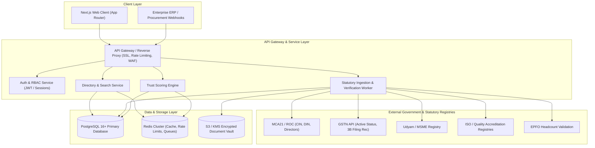
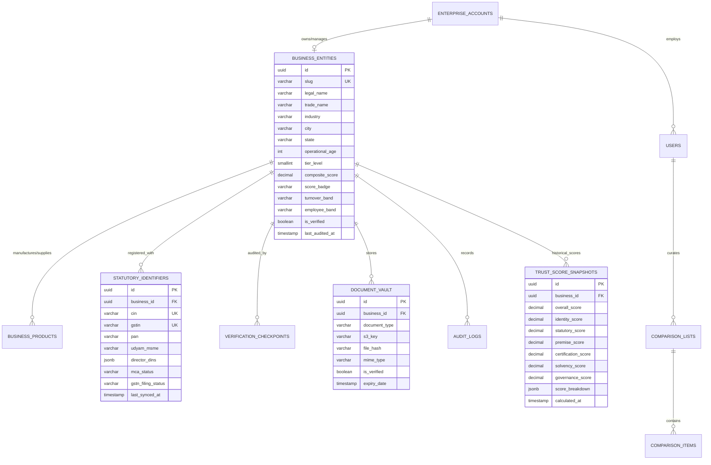

# BITAINTEL — API & Database Architecture Specification

This document provides the technical requirements, entity-relationship models, PostgreSQL schema designs, indexing strategies, RESTful API specifications, and external integration pipelines required to scale **BITAINTEL** into a high-throughput, enterprise-grade B2B trust intelligence platform.

---

## 1. System Architecture Overview



---

## 2. Database Requirements & Schema Design

### 2.1 Database Choice & Extensions
- **Engine**: PostgreSQL 16+
- **Extensions**:
  - `uuid-ossp` or `pgcrypto`: Deterministic UUID generation.
  - `pg_trgm`: Fast trigram fuzzy search across company names, locations, and products.
  - `btree_gin` / `btree_gist`: Multi-column composite indexing.
  - `citext`: Case-insensitive emails, usernames, and GSTIN/CIN fields.

---

### 2.2 Entity Relationship Diagram (ERD)



---

### 2.3 PostgreSQL DDL Schema Definitions

```sql
-- Enable necessary extensions
CREATE EXTENSION IF NOT EXISTS "uuid-ossp";
CREATE EXTENSION IF NOT EXISTS "pg_trgm";
CREATE EXTENSION IF NOT EXISTS "citext";

-- 1. Accounts & Organizations (Managing accounts)
CREATE TABLE enterprise_accounts (
    id UUID PRIMARY KEY DEFAULT uuid_generate_v4(),
    organization_name VARCHAR(255) NOT NULL,
    account_type VARCHAR(50) DEFAULT 'enterprise' CHECK (account_type IN ('standard', 'enterprise', 'auditor', 'admin')),
    is_active BOOLEAN DEFAULT TRUE,
    created_at TIMESTAMPTZ DEFAULT NOW(),
    updated_at TIMESTAMPTZ DEFAULT NOW()
);

-- 2. Users & Representatives
CREATE TABLE users (
    id UUID PRIMARY KEY DEFAULT uuid_generate_v4(),
    account_id UUID REFERENCES enterprise_accounts(id) ON DELETE CASCADE,
    email CITEXT UNIQUE NOT NULL,
    full_name VARCHAR(200) NOT NULL,
    mobile VARCHAR(20) NOT NULL,
    designation VARCHAR(150) NOT NULL,
    password_hash VARCHAR(255) NOT NULL,
    role VARCHAR(50) DEFAULT 'member' CHECK (role IN ('super_admin', 'compliance_officer', 'viewer', 'member')),
    mfa_enabled BOOLEAN DEFAULT FALSE,
    mfa_secret VARCHAR(100),
    email_verified_at TIMESTAMPTZ,
    created_at TIMESTAMPTZ DEFAULT NOW(),
    updated_at TIMESTAMPTZ DEFAULT NOW()
);

-- 3. Core Business Entity Profile
CREATE TABLE business_entities (
    id UUID PRIMARY KEY DEFAULT uuid_generate_v4(),
    account_id UUID REFERENCES enterprise_accounts(id) ON DELETE SET NULL,
    slug VARCHAR(150) UNIQUE NOT NULL,
    name VARCHAR(255) NOT NULL,
    legal_name VARCHAR(255) NOT NULL,
    initials VARCHAR(4) NOT NULL,
    industry VARCHAR(100) NOT NULL,
    location VARCHAR(200) NOT NULL,
    city VARCHAR(100) NOT NULL,
    state VARCHAR(100) NOT NULL,
    address TEXT NOT NULL,
    postal_code VARCHAR(20),
    level SMALLINT NOT NULL CHECK (level BETWEEN 1 AND 4),
    score DECIMAL(5, 2) NOT NULL DEFAULT 0.00 CHECK (score BETWEEN 0.00 AND 100.00),
    badge VARCHAR(20) NOT NULL CHECK (badge IN ('Platinum', 'Gold', 'Silver', 'Verified')),
    age INT NOT NULL DEFAULT 0,
    summary TEXT NOT NULL,
    turnover VARCHAR(100) NOT NULL,
    employees VARCHAR(50) NOT NULL,
    verified BOOLEAN DEFAULT FALSE,
    last_audited TIMESTAMPTZ DEFAULT NOW(),
    created_at TIMESTAMPTZ DEFAULT NOW(),
    updated_at TIMESTAMPTZ DEFAULT NOW()
);

-- 4. Products & Capabilities (Directory search & filtering)
CREATE TABLE business_products (
    id UUID PRIMARY KEY DEFAULT uuid_generate_v4(),
    business_id UUID REFERENCES business_entities(id) ON DELETE CASCADE,
    product_name VARCHAR(255) NOT NULL,
    category VARCHAR(100),
    created_at TIMESTAMPTZ DEFAULT NOW()
);

-- 5. Statutory Registry Linkage
CREATE TABLE statutory_identifiers (
    id UUID PRIMARY KEY DEFAULT uuid_generate_v4(),
    business_id UUID UNIQUE REFERENCES business_entities(id) ON DELETE CASCADE,
    cin VARCHAR(21) UNIQUE NOT NULL,
    gstin VARCHAR(15) UNIQUE NOT NULL,
    pan VARCHAR(10) NOT NULL,
    udyam_msme VARCHAR(30),
    mca_status VARCHAR(50) DEFAULT 'ACTIVE',
    gstn_status VARCHAR(50) DEFAULT 'ACTIVE',
    filing_frequency VARCHAR(50) DEFAULT 'Monthly (GSTR-3B)',
    director_dins JSONB DEFAULT '[]'::jsonb,
    statutory_payload JSONB DEFAULT '{}'::jsonb,
    last_synced_at TIMESTAMPTZ DEFAULT NOW()
);

-- 6. Quality Standards & Certifications
CREATE TABLE certifications (
    id UUID PRIMARY KEY DEFAULT uuid_generate_v4(),
    business_id UUID REFERENCES business_entities(id) ON DELETE CASCADE,
    title VARCHAR(150) NOT NULL, -- e.g. "ISO 9001:2015 & IATF 16949"
    issuer VARCHAR(200),
    certificate_number VARCHAR(100),
    issued_date DATE,
    expiry_date DATE,
    verification_status VARCHAR(50) DEFAULT 'VERIFIED' CHECK (verification_status IN ('VERIFIED', 'EXPIRED', 'PENDING', 'FLAGGED')),
    created_at TIMESTAMPTZ DEFAULT NOW()
);

-- 7. Verification Checkpoints Breakdown
CREATE TABLE verification_checkpoints (
    id UUID PRIMARY KEY DEFAULT uuid_generate_v4(),
    business_id UUID REFERENCES business_entities(id) ON DELETE CASCADE,
    checkpoint_type VARCHAR(100) NOT NULL, -- 'identity', 'documents', 'contact', 'address', 'profile'
    achieved_score DECIMAL(5, 2) NOT NULL,
    max_score DECIMAL(5, 2) NOT NULL,
    details JSONB DEFAULT '{}'::jsonb,
    audited_by UUID REFERENCES users(id),
    audited_at TIMESTAMPTZ DEFAULT NOW()
);

-- 8. Document Vault (Audit evidence)
CREATE TABLE document_vault (
    id UUID PRIMARY KEY DEFAULT uuid_generate_v4(),
    business_id UUID REFERENCES business_entities(id) ON DELETE CASCADE,
    document_category VARCHAR(100) NOT NULL, -- 'incorporation', 'gst_3b', 'audited_balance_sheet', 'iso_cert'
    file_name VARCHAR(255) NOT NULL,
    s3_key VARCHAR(500) NOT NULL,
    file_size_bytes BIGINT NOT NULL,
    mime_type VARCHAR(100) NOT NULL,
    sha256_checksum CHAR(64) NOT NULL,
    is_tamper_evident BOOLEAN DEFAULT TRUE,
    verification_status VARCHAR(50) DEFAULT 'PENDING' CHECK (verification_status IN ('PENDING', 'VERIFIED', 'REJECTED')),
    uploaded_by UUID REFERENCES users(id),
    created_at TIMESTAMPTZ DEFAULT NOW()
);

-- 9. Historical Score Snapshots (Time-series auditability)
CREATE TABLE trust_score_snapshots (
    id UUID PRIMARY KEY DEFAULT uuid_generate_v4(),
    business_id UUID REFERENCES business_entities(id) ON DELETE CASCADE,
    composite_score DECIMAL(5, 2) NOT NULL,
    tier VARCHAR(50) NOT NULL,
    grade VARCHAR(5) NOT NULL,
    weight_breakdown JSONB NOT NULL,
    calculated_at TIMESTAMPTZ DEFAULT NOW()
);

-- 10. User Comparison Lists
CREATE TABLE comparison_lists (
    id UUID PRIMARY KEY DEFAULT uuid_generate_v4(),
    user_id UUID REFERENCES users(id) ON DELETE CASCADE,
    title VARCHAR(150) DEFAULT 'Default Comparison',
    created_at TIMESTAMPTZ DEFAULT NOW()
);

CREATE TABLE comparison_items (
    id UUID PRIMARY KEY DEFAULT uuid_generate_v4(),
    comparison_list_id UUID REFERENCES comparison_lists(id) ON DELETE CASCADE,
    business_id UUID REFERENCES business_entities(id) ON DELETE CASCADE,
    added_at TIMESTAMPTZ DEFAULT NOW(),
    UNIQUE(comparison_list_id, business_id)
);
```

---

### 2.4 Indexing & Query Optimization Strategy

```sql
-- Fast trigram text search on company names, legal names, and products
CREATE INDEX idx_business_name_trgm ON business_entities USING gin (name gin_trgm_ops);
CREATE INDEX idx_business_legal_name_trgm ON business_entities USING gin (legal_name gin_trgm_ops);
CREATE INDEX idx_products_name_trgm ON business_products USING gin (product_name gin_trgm_ops);

-- Directory Explorer Filter Indexes
CREATE INDEX idx_business_filter_composite ON business_entities (industry, level, score DESC, verified);
CREATE INDEX idx_business_state_city ON business_entities (state, city);
CREATE INDEX idx_business_slug ON business_entities (slug);

-- Statutory Lookups
CREATE INDEX idx_statutory_cin ON statutory_identifiers (cin);
CREATE INDEX idx_statutory_gstin ON statutory_identifiers (gstin);
CREATE INDEX idx_statutory_pan ON statutory_identifiers (pan);

-- Document Vault Security Lookups
CREATE INDEX idx_doc_vault_business_cat ON document_vault (business_id, document_category);
```

---

## 3. Trust Scoring Engine Formula & Logic

The composite score ($S$) is calculated on a 0–100 scale using 6 weighted statutory dimensions:

$$S = \sum_{i=1}^{6} (w_i \times s_i)$$

| Dimension ($i$) | Weight ($w_i$) | Description & Data Source |
|---|---|---|
| **Corporate Legal Identity** | **20%** | MCA active status, CIN consistency, Director DIN checks, Registered Office proof. |
| **Tax & Statutory Compliance** | **20%** | Real-time GSTN filing continuity (GSTR-3B/GSTR-1 last 24 mo), PAN reconciliation. |
| **Operational Tenure & Footprint** | **15%** | Years operational ($age$), physical premise lease/ownership verification, EPFO headcount. |
| **Quality & Industry Accreditations** | **15%** | Active ISO (9001/27001/14001), IATF, WHO-GMP, RoHS certificates with unexpired validity. |
| **Financial Solvency Signals** | **15%** | Audited balance sheets, turnover consistency band, credit risk flags. |
| **Governance & Security Safeguards** | **15%** | Statutory auditor remarks, litigation watch-list checks, privacy compliance. |

### Tier Classification Matrix
- **90.00 – 100.00**: `Platinum Tier` (`Grade A+` for $\ge 95$, `Grade A` for $\ge 90$)
- **80.00 – 89.99**: `Gold Tier` (`Grade B+` for $\ge 85$, `Grade B` for $\ge 80$)
- **70.00 – 79.99**: `Silver Tier` (`Grade C+` for $\ge 75$, `Grade C` for $\ge 70$)
- **50.00 – 69.99**: `Audited` (`Grade D`)
- **0.00 – 49.99**: `Under Review` (`Grade F`)

---

## 4. End-to-End RESTful API Specifications

All endpoints return unified JSON responses wrapped in standard response objects.

```typescript
// Standard API Envelope
interface ApiResponse<T> {
  success: boolean;
  data: T;
  meta?: {
    page?: number;
    limit?: number;
    total?: number;
    timestamp: string;
  };
  error?: {
    code: string;
    message: string;
    details?: unknown;
  };
}
```

---

### 4.1 Authentication & Profile Endpoints

#### `POST /api/v1/auth/register`
Initiates representative onboarding with corporate credentials.
- **Request Body**:
```json
{
  "representativeName": "Priya Iyer",
  "email": "priya.iyer@meridiansteel.com",
  "mobile": "+919822019281",
  "designation": "Director / Authorized Signatory",
  "companyName": "Meridian Steel Works",
  "cin": "U27100PN2003PTC148921",
  "gstin": "27AABCM8291Q1Z4",
  "industry": "Manufacturing",
  "state": "Maharashtra",
  "turnover": "₹50–100 crore",
  "password": "SecurePassword123!"
}
```
- **Response**: `201 Created` with JWT access token, refresh token, and initial onboarding state.

#### `POST /api/v1/auth/login`
- **Request Body**: `{ "email": "...", "password": "..." }`
- **Response**: `200 OK` `{ "accessToken": "...", "refreshToken": "...", "user": { ... } }`

---

### 4.2 Directory Explorer & Search Endpoints

#### `GET /api/v1/businesses`
Powers directory searching, faceted filtering, pagination, and sorting.
- **Query Parameters**:
  - `q` (string): Text query matching company name, legal name, products, or location.
  - `industry` (string): e.g. `Manufacturing`, `IT Services`.
  - `level` (number): `1`, `2`, `3`, or `4`.
  - `minScore` (number): Minimum score threshold (0–100).
  - `verified` (boolean): `true` to filter verified entities only.
  - `state` (string): Filter by state.
  - `sortBy` (enum): `score_desc`, `tenure_desc`, `name_asc`.
  - `page` (number): Default `1`.
  - `limit` (number): Default `12` (max `50`).

- **Response `200 OK`**:
```json
{
  "success": true,
  "data": [
    {
      "id": "meridian-steel-works",
      "name": "Meridian Steel Works",
      "legalName": "Meridian Advanced Materials & Steelworks Pvt. Ltd.",
      "initials": "MS",
      "industry": "Manufacturing",
      "location": "Pune, Maharashtra",
      "level": 4,
      "score": 96.00,
      "badge": "Platinum",
      "age": 23,
      "summary": "Precision steel fabricator supplying high-tolerance structural...",
      "products": ["Precision Structural Steel", "CNC Machined Alloys"],
      "gstin": "27AABCM8291Q1Z4",
      "cin": "U27100PN2003PTC148921",
      "isoCertified": "ISO 9001:2015 & IATF 16949",
      "turnover": "₹50–100 crore",
      "verified": true,
      "lastAudited": "2026-10-12T00:00:00.000Z"
    }
  ],
  "meta": {
    "page": 1,
    "limit": 12,
    "total": 14280,
    "timestamp": "2026-10-21T11:22:00.000Z"
  }
}
```

---

### 4.3 Detailed Dossier & Comparison Endpoints

#### `GET /api/v1/businesses/:slugOrId`
Fetches the complete audited corporate dossier, including verification breakdown checkpoints.
- **Response `200 OK`**:
```json
{
  "success": true,
  "data": {
    "id": "meridian-steel-works",
    "name": "Meridian Steel Works",
    "legalName": "Meridian Advanced Materials & Steelworks Pvt. Ltd.",
    "cin": "U27100PN2003PTC148921",
    "gstin": "27AABCM8291Q1Z4",
    "score": 96.00,
    "badge": "Platinum",
    "checkpoints": {
      "identity": { "score": 10, "max": 10, "status": "VERIFIED" },
      "documents": { "score": 20, "max": 20, "status": "VERIFIED" },
      "contact": { "score": 5, "max": 5, "status": "VERIFIED" },
      "address": { "score": 5, "max": 5, "status": "VERIFIED" },
      "profile": { "score": 15, "max": 15, "status": "VERIFIED" }
    },
    "certifications": [
      {
        "title": "ISO 9001:2015",
        "issuer": "TÜV SÜD",
        "validUntil": "2027-11-30"
      }
    ],
    "directors": [
      { "name": "Rajesh Sharma", "din": "00291024", "status": "ACTIVE" }
    ]
  }
}
```

#### `GET /api/v1/businesses/compare?ids=id1,id2,id3,id4`
Powers side-by-side comparative analysis of up to 4 enterprises.

---

### 4.4 Document Vault & Ingestion Pipeline

#### `POST /api/v1/documents/presigned-url`
Generates a pre-signed S3 URL for tamper-evident document deposition.
- **Request Body**:
```json
{
  "businessId": "uuid-here",
  "documentCategory": "audited_balance_sheet",
  "fileName": "audited_fy25_26.pdf",
  "mimeType": "application/pdf",
  "sha256": "e3b0c44298fc1c149afbf4c8996fb92427ae41e4649b934ca495991b7852b855"
}
```
- **Response**:
```json
{
  "uploadUrl": "https://bitaintel-vault.s3.ap-south-1.amazonaws.com/...",
  "documentId": "generated-doc-uuid"
}
```

#### `POST /api/v1/documents/:id/verify-checksum`
Confirms receipt, validates cryptographic checksum, and queues OCR/automated inspection.

---

### 4.5 Statutory Registry Webhook & Cron Ingestion

#### `POST /api/v1/webhooks/statutory/mca`
Receives MCA21 / ROC company status, director changes, and filing updates.

#### `POST /api/v1/webhooks/statutory/gstn`
Receives GSTR-3B tax payment continuity signals and filing frequency updates.

---

## 5. Security, Caching, and Enterprise Non-Functional Requirements

1. **Authentication & Authorization**:
   - OAuth 2.0 / OpenID Connect with JSON Web Tokens (access: 15 min TTL, refresh: 7 days TTL).
   - Role-Based Access Control (RBAC): `platform_admin`, `compliance_auditor`, `enterprise_user`, `public_viewer`.
2. **Encryption Standards**:
   - Data at Rest: AES-256 with AWS KMS / HashiCorp Vault.
   - Data in Transit: TLS 1.3 enforced across all endpoints.
3. **Caching Strategy (Redis 7+)**:
   - Full Business Profiles cached with 1-hour TTL (`business:{slug}`).
   - Directory Search Results cached with 5-minute TTL (`dir:query_hash`).
   - Invalidation triggered on score recalculation or statutory webhook update.
4. **Rate Limiting & Anti-Scraping**:
   - Public Directory Explorer: 60 requests/minute per IP (token bucket via Redis).
   - Enterprise API Consumers: 10,000 requests/minute via API Key with dedicated quota management.
5. **Audit Logging (Compliance)**:
   - Immutable audit logs capturing every document inspection, score calculation, and profile edit.
